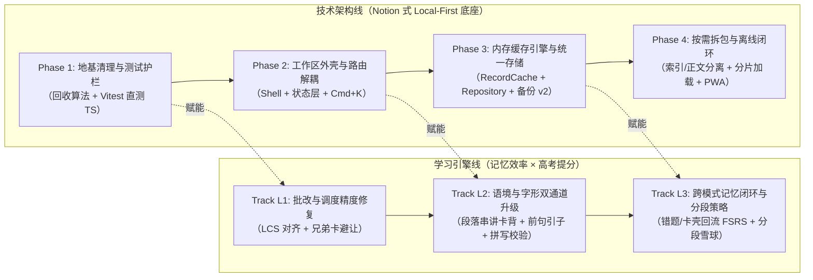

# 文言背诵 Web 版 · 架构演进路径图与远期规划 Checklist

> **定位**：面向「纯前端、零后端、100% 离线」定位的 **Notion 式 Local-First（本地优先）架构**演进蓝图。  
> **配套文档**：[DESIGN_SYSTEM.md](./DESIGN_SYSTEM.md) · [AGENTS.md](../AGENTS.md)

---

## 1. 现状诊断与目标架构

### 1.1 当前架构基线（截至 2026-11）

项目当前处于**「纯前端分层 SPA（偏视图驱动）」**阶段：

- **入口与路由调度**：`src/App.tsx` 通过本地 `useState<NavView>` 切换 8 个视图（其中 7 个视图已做 `React.lazy` 懒加载），状态（`selectedScope`、`activeArticleId`、`resumeExtra` 等）以 Props 向下透传，尚未接入 URL Hash 同步。
- **视图层体积与重复**：5 个主学习视图偏厚（`FlipCardView` 869 行、`CramModeView` 863 行、`SnowballView` 720 行、`ScenarioView` 556 行、`ClozeView` 555 行），各自维护选篇弹窗（`SnowballView` / `ClozeView` 重复实现）与全局 `keydown` 监听。
- **领域层边界泄露**：`src/domain/` 已承载 FSRS-5、Anki 排程、滚雪球与遮挡算法，但仍有核心算法留在视图内（`ScenarioView` 逐字 Diff、`ClozeView` 关键词提取）。
- **静态数据全量打包**：`npm run build` 下主包 `index-*.js` 为 `423.99 kB`（含 161 KB 全量正文 `curriculumData.ts` 与模块加载即预热的 `flashcardCache.ts`），`UnderstandingCard-*.js` 为 `131.42 kB`（静态导入全部 `learningContent/part1~5.ts`）。
- **本地存储双轨割裂**：学习记录分别落在 IndexedDB（`src/storage/db.ts`：`cards`、`logs`、`daily_records`、`bottlenecks`、`settings`）与 `localStorage`（`wenyan_last_session`、`wenyan_cram_ratings`、`wenyan_anki_expanded_decks`、`snowball_stage_*`、`wenyan_minimal_theme`）；导出/导入备份仅覆盖 `cards` 与 `daily_records`。
- **测试与离线闭环**：根目录现有 4 个 `.mjs` 脚本以源码文本断言或函数拷贝为主，尚未直接对 `src/domain/` TypeScript 源码跑自动化单测；`public/` 仅有 `_headers` 与 `_redirects`，尚未接入 Service Worker 离线缓存（PWA）。

### 1.2 学习引擎与教研体验现状

从学习科学和高考默写提分角度审视，当前五种模式也存在几处明显短板：

- **批改对齐错位**：`ScenarioView.tsx` 的 `diffResult` 采用固定下标逐位比对，学生漏字或多字会导致后续原本写对的字全部错位标红。
- **闪卡语境失真与兄弟卡扎堆**：`flashcardGenerator.ts` 把全篇首句译文 `article.translation` 赋给每一张卡片的 `backTranslation`；已生成的 `precedingClauseHint`（前句引子）在 `FlipCardView.tsx` 中未被渲染；同句正反挖空卡（`UPPER_PROMPT_LOWER` / `LOWER_PROMPT_UPPER`）在 `ankiScheduler.ts` 中无同日避让（Sibling Burying），同日反复出现同一句、挤占新学配额。
- **五模式记忆数据孤岛化**：目前仅 `FlipCardView` 与 `SnowballView` 结业写入 FSRS 与 `daily_records`；`ClozeView`、`ScenarioView` 错题和 `CramModeView` 的 `stuck` 标记不会反哺 FSRS 调度，滚雪球 `bottlenecks` 也没有在全局聚合成卡壳专练队列。
- **长篇滚雪球颗粒度粗**：长文（如《离骚》《琵琶行》）必须通篇滚完才写入 FSRS，且结业一次性写入全部变体卡易撑爆当日配额；缺乏按自然段结算与「段尾接下段首句」的衔接训练。
- **字形输入校验缺失**：除高考默写外其余模式均为心想/点击自检，缺少针对通假字与易错实词的手写/输入校验。

### 1.3 目标架构：Notion 式技术底座与学习闭环

把 Notion 客户端最核心的工程思路落地到纯前端背诵场景，聚焦四根支柱：

1. **客户端响应式缓存（Client RecordCache + Optimistic Write）**  
   启动时将 IndexedDB 用户状态一次性水合进内存 Store；所有视图直接从内存同步读取派生状态，评分/打卡先即时更新 UI，再在后台异步落盘 IndexedDB，消除跨页切回时的统计延迟与状态不同步。
2. **一份数据，多种视图（Normalized Repository + Multi-View）**  
   将「篇目 → 段落/句读单元 → 闪卡 / 难词注音 / 串讲 / 高考真题」整理为统一索引仓库。滚雪球、闪卡、刻漏字、抱佛脚、情境默写只是消费同一套数据模型的不同视图，卡壳点与薄弱项可跨模式打通。
3. **统一工作区外壳与命令层（Workspace Shell + Command Palette）**  
   将 `StudyToolbar`、`StudySidebar`、右侧滑出抽屉、全局快捷键调度与选篇入口收拢为统一工作区外壳，并补齐 `Cmd/Ctrl + K` 命令面板，实现 Notion 式「外框常驻、画布切换、键盘直达」。
4. **索引常驻、正文按需 + 真离线（Index First, Lazy Content + PWA）**  
   首屏只保留轻量篇目索引（元数据），正文、注释、串讲按篇/分册动态加载，并配合 Service Worker 预缓存静态资源，断网刷新也能秒开。

### 1.4 演进必须守住的约束

- **零后端原则**：不引入服务端、登录态或运行时外部 API 请求。
- **数据兼容**：现有用户的 IndexedDB（`wenyan_recitation_db`）与 `localStorage` 进度升级后必须无损迁移，旧版 JSON 备份保持可读。
- **边界合规**：不直接手工改动自动生成的 `src/data/curriculumData.ts` 正文；所有迭代小步可验证，每步均通过 `npm run build`。

---

## 2. 双轨演进路径图（技术底座 × 学习引擎）

技术重构与学习体验升级双轨并进：技术侧每落稳一层，就立刻释放对应的学习能力升级。

| 阶段对应 | 技术架构主题 | 同步解锁的学习引擎升级 |
|:---|:---|:---|
| **Phase 1 / Track L1** | 地基清理与测试护栏 | 抽离 `diffEngine` 后落地 LCS 精准对齐；在 Vitest 护航下补齐 `ankiScheduler` 兄弟卡避让与雪球记卡隔离 |
| **Phase 2 / Track L2** | 工作区外壳与命令层 | 闪卡背面接入段落串讲与难词注音、正面开放 `precedingClauseHint` 前句引子，并支持易错字输入校验 |
| **Phase 3 / Track L3** | 内存缓存与统一存储 | 依托统一 Repository 打通 5 模式 FSRS/卡壳回流、聚合「易卡壳急救包」、长文分段滚雪球与段间衔接卡 |
| **Phase 4** | 按需拆包与离线 PWA | —（纯工程与离线交付阶段，为全站及前序学习能力提供秒开与断网支撑） |

---

## 3. 远期规划 Checklist（技术架构线 · Phase 1–4）

> 使用说明：按 Phase 顺序推进，每勾完一项需更新根目录 `CHANGELOG.md` 并通过构建与测试校验。

### Phase 1：地基清理与测试护栏（优先启动）

- [x] **1.1 回收视图内泄露的领域逻辑到 `src/domain/`**
  - 将 `src/views/ScenarioView.tsx` 的标点归一化与逐字批改算法抽离为 `src/domain/scenario/diffEngine.ts`
  - 将 `src/views/ClozeView.tsx` 的考点词提取与虚词过滤逻辑抽离为 `src/domain/cloze/keywordExtractor.ts`
  - **验收**：视图文件不再包含纯字符串匹配/Diff 算法，纯函数可独立导入运行
- [x] **1.2 建立 Vitest 单元测试与数据一致性门禁**
  - 引入 `vitest`，将 `npm test` 接入测试执行（保留或平滑替代现有拷贝代码的 `.mjs` 脚本）
  - 覆盖核心纯模块：`fsrsEngine.ts`（含学习步进预览与间隔边界）、`ankiScheduler.ts`（每日配额与错词重入队）、`clozeEngine.ts`、`snowballEngine.ts`、`diffEngine.ts`、`getLocalDateString` 跨零点边界
  - 新增数据完整性校验测试：验证 `ARTICLE_PHONETICS` / `ARTICLE_UNDERSTANDING` 覆盖全部 100 个 `articleId`，且每篇 `paragraphGists.length === article.paragraphs.length`
  - **验收**：`npm test` 零失败，CI（`.github/workflows/deploy.yml`）部署前自动运行 `npm test && npm run build`
- [x] **1.3 拆分超长学习视图（状态逻辑与 UI 解耦）**
  - 将 `FlipCardView.tsx` 的队列构建、FSRS 评分和错词重入队状态机抽离为 `src/hooks/useFlipCardSession.ts`，拆出结算页子组件
  - 将 `CramModeView.tsx` 拆分为卡片背诵子组件与列表速查子组件
  - **验收**：单文件视图行数收敛至 350 行以内，功能与快捷键体验保持一致

---

### Phase 2：工作区外壳、状态收拢与命令层

- [x] **2.1 引入轻量应用状态层 + URL Hash 同步**
  - 用轻量状态方案（React Context 分层或 `zustand`）集中管理 `currentView`、`selectedScope`、`activeArticleId`、`resumeExtra`、`theme`、`soundEnabled`
  - 消除 `App.tsx` 向 8 个视图的 Prop Drilling，并同步 URL Hash（如 `#/snowball/art_bx1_12`）
  - **验收**：支持浏览器前进/后退切换学习视图，刷新页面能停留在当前模式与篇目
- [x] **2.2 收拢统一工作区外壳 `<StudyWorkspaceShell>`**
  - 统一承载 `StudyToolbar`、主画布、xl 右栏 `StudySidebar`、右侧滑出抽屉（`PhoneticsPanel` / `UnderstandingCard`）以及「恢复上次进度」提示条
  - 抽离全局统一快捷键调度 Hook（`useWorkspaceShortcuts`），集中处理输入框屏蔽、弹窗开启时冻结快捷键、以及与 `Alt + 1~8` 的修饰键隔离
  - **验收**：新增或调整工具栏/右侧抽屉能力只需修改外壳一处，`SnowballView` / `ClozeView` / `ScenarioView` / `FlipCardView` 不再重复维护外框与全局 `keydown` 监听
- [x] **2.3 统一选篇弹窗与 Notion 式 `Cmd/Ctrl + K` 命令面板**
  - 先将 `SnowballView` 与 `ClozeView` 重复的朝代筛选 + 搜索选篇弹窗抽离为通用组件 `src/components/ArticlePickerModal.tsx`
  - 进一步升级为全局命令面板（`Cmd/Ctrl + K`），支持一句话搜索切换篇目、直达 5 种学习模式、切换教材范围与主题
  - **验收**：全站任意页面按 `Cmd/Ctrl + K` 可秒搜 100 篇古诗文与功能指令

---

### Phase 3：Notion 式客户端缓存引擎与统一存储

- [x] **3.1 构建响应式客户端缓存层（Client RecordCache）**
  - 在 `src/storage/db.ts` 之上建立内存态 `StudyStore`：应用启动时异步预水合 `cards`、`daily_records`、`bottlenecks`、`settings` 到 `Map` 索引
  - 评分、打卡、标记卡壳点均先乐观更新内存态并即时驱动各组件重新派生统计，后台微任务/批量异步写入 IndexedDB
  - **验收**：`DashboardView` 指标卡片、`AnkiDeckHub` 三色统计、`CatalogView` 掌握度筛选均实现 0ms 内存派生与跨视图实时一致，不再各处重复 `getAllCardStates()`
- [x] **3.2 建立「一份数据、多视图共享」的标准化实体索引**
  - 建立只读组合层 `src/data/articleRepository.ts`，以 `articleId` 和段落/句索引为主键，统一关联正文、`flashcardCache` 卡片、`goldenVersesData` 金句、`scenarioData` 高考真题、`bottlenecks` 卡壳标记
  - **验收**：在滚雪球标记卡壳的段落/句子，可在闪卡或典库详情中关联可见，减少各视图各自 `.find()` / `.filter()` 拼装
- [x] **3.3 统一本地持久化与全量备份 Schema v2**
  - 将零散在 `localStorage` 的业务状态（`wenyan_cram_ratings`、滚雪球进度 `snowball_stage_*`、牌组展开偏好等）收敛至统一存储适配器（或迁移进 IndexedDB `settings` / 专属 store，保留初次启动自动迁移）
  - 升级备份导出/导入格式为 `version: 2`，覆盖 `cards`、`logs`、`daily_records`、`bottlenecks`、`settings` 与各模式学习进度，同时向下兼容旧版（无 `version` 或 `v1`）JSON 导入
  - **验收**：清空浏览器数据后通过单份 JSON 导入，可完整恢复 FSRS 记忆曲线、卡壳标记、抱佛脚掌握标记与用户参数设置

---

### Phase 4：按需分片加载与真正离线 PWA

- [x] **4.1 拆分「轻量篇目索引」与「正文数据」**
  - 从 `curriculumData.ts` 派生构建期轻量化元数据索引（仅含 `id`、`title`、`author`、`dynasty`、`book`、`genre`、`isGaoKao72`、`charCount`、`paragraphCount`，预计 < 25 KB），供首页、导航栏范围弹窗、典库列表与命令面板首屏使用
  - 篇目正文、注释、译文按册或按篇动态 `import()` 懒加载，移除 `flashcardCache.ts` 在模块顶层同步预热带来的首屏绑定
  - **验收**：首屏主包体积（当前 `423.99 kB`）显著下降，切换单个篇目正文无感知延迟
- [x] **4.2 注音与理解串讲数据按片按需加载**
  - 将 `src/data/articleUnderstanding.ts` 与 `src/data/articlePhonetics.ts` 改为按 `articleId` 路由到 `part1~5.ts` 的动态 `import()`，仅在打开注音/理解抽屉或进入 L1 挖空时按需加载对应分片
  - **验收**：`UnderstandingCard` 自身代码包从当前的 `131.42 kB` 剥离掉全量语料，仅保留抽屉 UI 逻辑
- [x] **4.3 接入 PWA 离线缓存与可安装支持**
  - 接入 `vite-plugin-pwa`，生成 Web App Manifest（名称、图标、独立窗口模式）与 Service Worker，预缓存 `dist/` 下所有静态资源与按需分片 JS
  - 处理静态资源更新提示（新版本就绪后温和提示用户刷新激活，避免打断背诵心流）
  - **验收**：部署到 Cloudflare Pages 并首次访问后，断开网络（飞行模式）刷新页面仍可正常打开并完成全流程背诵与 FSRS 评分

---

## 4. 远期规划 Checklist（学习引擎与教研体验线 · Track L）

### Track L1：批改与调度精度修复（配合 Phase 1）

- [x] **L1.1 高考默写升级为 LCS / 编辑距离精准批改**
  - 将 `diffEngine.ts` 从固定下标逐位对比改为最小编辑距离（Levenshtein / LCS）对齐，精确区分「错字」「漏字」「多字」三类错误
  - 批改失败时高亮关联 `keyPoints`（通假字、定语后置、偏旁易混字）采分提醒
  - **验收**：句首或句中漏写 1 字时，后续正确字符不再整体错位标红
- [x] **L1.2 闪卡调度增加「兄弟卡同日避让（Sibling Burying）」**
  - 在 `ankiScheduler.ts` 中按 `segmentId` 识别同一分句组的正反挖空卡（如 `UPPER_PROMPT_LOWER` 与 `LOWER_PROMPT_UPPER`），每日新学与复习队列默认同日只排 1 张（优先 `isPrimary`），另一张自动顺延至次日
  - **验收**：单次 20 张新学会话不再连续出现同一句话的双向挖空，每日配额覆盖更多不同名句
- [x] **L1.3 修正滚雪球结业写卡与每日配额隔离**
  - 滚雪球结业批量写入 FSRS 时，按 `segmentId` 主卡记账（或提供单独的雪球复习配额标记），避免完成一篇 20+ 联的长文瞬间挤满当日闪卡新学/复习额度
  - **验收**：完成《赤壁赋》《琵琶行》滚雪球后，闪卡页当日配额统计与预计学习量保持合理

### Track L2：闪卡与刻漏字语境及字形双通道升级（配合 Phase 2）

- [x] **L2.1 修复闪卡背面译文失真，接入段落串讲与难词注音**
  - 替换 `flashcardGenerator.ts` 中全篇共用首句译文 `article.translation` 的做法，改为在卡背动态匹配 `ARTICLE_UNDERSTANDING` 对应段落的 `paragraphGists` 与本句命中的 `ARTICLE_PHONETICS`（含通假标识）
  - **验收**：任意篇目任意段落的闪卡背面都能展示与当前句对应的段意串讲与难词读音
- [x] **L2.2 开放正面「前句引子」按需提示与语境连背**
  - 在 `FlipCardView` 正面接入 `precedingClauseHint`，提供轻量「提示上一句（H）」交互，解决长文起头断片问题
  - 增加「按课文语序连背」开关，方便初背期形成文脉节奏感
  - **验收**：按 `H` 或点击提示可展开前句引子，不破坏纯盲背默认体验
- [x] **L2.3 增加易错字输入校验模式（Typing Recall）**
  - 在刻漏字 `L1 关键词`（优先聚焦通假字/破读字/高频易错实词）与闪卡模式中，提供可选的「手打盲默」校验开关，强化「嘴会背、手不写错」的字形过关
  - **验收**：用户在闪卡或刻漏字开启输入校验时，可直接输入关键字并获得即时正误反馈

### Track L3：跨模式记忆闭环与长篇分段策略（配合 Phase 3）

- [x] **L3.1 打通五模式记忆回流与「高频卡壳急救包」**
  - 高考默写答错题目自动触发对应篇目/句子的 FSRS 降权或提前复习，并将有效练习计入 `daily_records` 热力图
  - 聚合滚雪球 `bottlenecks`、抱佛脚 `stuck` 与高考默写错题，在闪卡主控台与首页提供「高频卡壳急救队列」一键专刷
  - **验收**：任意模式标记的卡壳/错题均可在统一急救队列中复练并更新复习记录
- [x] **L3.2 长篇支持「按自然段分段滚雪球」与「段间接口衔接卡」**
  - 对 `paragraphs.length >= 3` 的长篇，支持选择「分段攻坚（每段独立滚雪球并阶段结算）」或「全篇通滚」
  - 针对古文最易跳段/记串的痛点，自动生成「上段末句 → 默写下段首句」的段间接口卡
  - **验收**：长篇中途退出前可先完成单段结算沉淀记忆，段与段衔接处可单独训练
- [x] **L3.3 背诵结算联动本篇高考理解性默写**
  - 在滚雪球或单篇闪卡完成结算页，自动检索 `GAOKAO_SCENARIO_QUESTIONS` 中匹配当前 `articleId` 的真题，提供「顺手做 N 道本篇高考真题」直达入口
  - **验收**：背完《劝学》《赤壁赋》等有真题篇目后，可一键进入本篇专项情境默写检验
